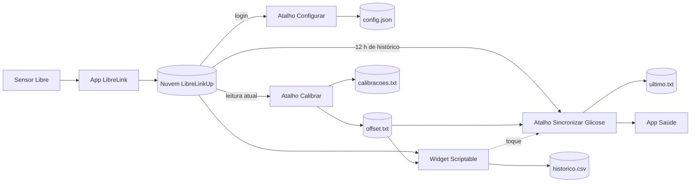

# Libre → Saúde, com calibração

Leva as leituras do sensor **FreeStyle Libre** para o app **Saúde** do iPhone, já corrigidas por um offset calculado a partir das suas medições de ponta de dedo. Inclui um widget com a glicose atual, a média do dia e a glicada estimada.

Tudo roda no próprio iPhone, com o app **Atalhos** e o **Scriptable**. Não precisa de Mac, de conta de desenvolvedor nem de servidor.

> **Aviso.** Este projeto não é oficial e não tem ligação com a Abbott. Ele usa a API não documentada do LibreLinkUp, que pode mudar sem aviso. **Não use estes dados para decidir doses de insulina ou tratamento.** Para alarmes e decisões, use o app oficial e o glicosímetro.

## O que ele faz

- **Sincroniza** as leituras do Libre com o app Saúde, várias vezes por dia, sem duplicar.
- **Calibra por sensor**: você informa a glicemia capilar uma ou mais vezes em cada sensor novo, e o offset daquele sensor passa a ser a média das diferenças (capilar − sensor).
- **Pausa a sincronização** quando entra um sensor novo sem calibração, e avisa.
- **Mostra um widget** com o valor atual corrigido, a seta de tendência, a média de hoje e a glicada estimada (GMI) com até 120 dias de dados. Um toque no widget roda a sincronização.

## Como as peças se ligam



Os arquivos entre parênteses ficam numa pasta `Libre` dentro da pasta do app Atalhos no iCloud Drive.

## O que você precisa

- iPhone com iOS 17 ou mais novo
- App **Atalhos** (já vem no iPhone)
- App **Scriptable** (grátis na App Store), só para o widget
- Sensor FreeStyle Libre usando o app **FreeStyle LibreLink**
- Uma conta **LibreLinkUp de seguidor**, com um e-mail diferente do que você usa no LibreLink
- Glicosímetro para as calibrações

## Ordem de montagem

| # | Etapa | Documento |
| --- | --- | --- |
| 0 | Preparar a conta de seguidor e a pasta | [docs/00-preparacao.md](docs/00-preparacao.md) |
| 1 | Atalho **Libre - Converter Data** | [docs/01-converter-data.md](docs/01-converter-data.md) |
| 2 | Atalho **Libre - Configurar** | [docs/02-configurar.md](docs/02-configurar.md) |
| 3 | Atalho **Libre - Calibrar** | [docs/03-calibrar.md](docs/03-calibrar.md) |
| 4 | Atalho **Libre - Sincronizar Glicose** | [docs/04-sincronizar.md](docs/04-sincronizar.md) |
| 5 | Automações | [docs/05-automacoes.md](docs/05-automacoes.md) |
| 6 | Widget no Scriptable | [docs/06-widget-scriptable.md](docs/06-widget-scriptable.md) |
| — | Solução de problemas | [docs/07-solucao-de-problemas.md](docs/07-solucao-de-problemas.md) |
| — | Como funciona por dentro | [docs/08-como-funciona.md](docs/08-como-funciona.md) |

Monte nessa ordem e teste cada atalho antes de seguir. Os atalhos são montados à mão no app Atalhos, porque o iOS só importa atalhos assinados. Cada documento lista uma ação por passo, com todos os campos que você precisa preencher.

## Arquivos deste repositório

```
README.md
LICENSE
docs/
  00-preparacao.md
  01-converter-data.md
  02-configurar.md
  03-calibrar.md
  04-sincronizar.md
  05-automacoes.md
  06-widget-scriptable.md
  07-solucao-de-problemas.md
  08-como-funciona.md
scriptable/
  Libre Glicose.js
```

## Privacidade

- A senha do LibreLinkUp **não** é guardada. O atalho Configurar salva só o token de acesso, no seu iCloud Drive.
- O token dá acesso de leitura à sua glicose por cerca de 6 meses. Não compartilhe o `config.json` nem prints que mostrem o token.
- Nenhum dado sai do seu iPhone, a não ser as chamadas à própria API do LibreLinkUp.

## Fontes

- Documentação comunitária da API do LibreLinkUp: <https://gist.github.com/khskekec/6c13ba01b10d3018d816706a32ae8ab2>
- Mudança de outubro de 2025 (versão 4.16.0 e cabeçalho `Account-Id`): <https://glama.ai/mcp/servers/@sedoglia/librelink-mcp-server/blob/f12292176ed6a30a7be61024b47e8074edcb5629/README.en.md>
- Regiões do LibreLinkUp: <https://elements.heroku.com/buttons/timoschlueter/nightscout-librelink-up>
- Fórmula do GMI (Bergenstal et al., 2018): <https://provider.dexcom.com/what-glucose-management-indicator-gmi>

## Licença

MIT. Veja [LICENSE](LICENSE).
